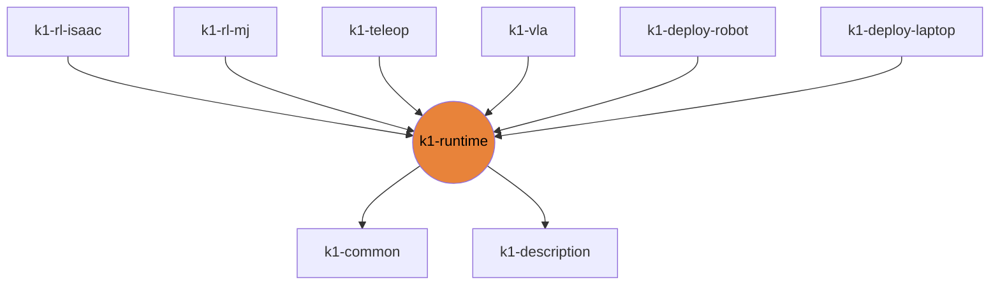

# k1-runtime

Torch/numpy-only policy runtime: WBC, push-IK core, arm IK, DS4 pad, gamepad core.

| | |
|---|---|
| Layer | **L1**: Core (torch / numpy only) |
| May import | [k1-common](https://github.com/thdhyan/k1-common), [k1-description](https://github.com/thdhyan/k1-description) |
| Files / LOC | 8 files · 1,466 lines (py, sh, cpp) |
| Part of | [k1-workspace](https://github.com/thdhyan/k1-workspace) (architecture and layering rules live there) |

## Where it sits



Used by: k1-rl-isaac, k1-rl-mj, k1-teleop, k1-vla, k1-deploy-robot, k1-deploy-laptop.


## Install

```bash
uv add git+https://github.com/thdhyan/k1-runtime
# or, from a checkout
uv sync
```

## Usage

Policy runtime with torch and numpy only. The same files run on the laptop and on the robot.

| Module | What |
|---|---|
| `wbc` | decoupled WBC: `LocoCmd`, `HeadCmd`, `ArmCmd`, `DecoupledWBC`, joint tables |
| `gamepad_core` | gains, `Walker`, `Body`, `ArmJog`, UDP `Gamepad` parser. Shared by the robot runner (k1-deploy-robot) and the sim (k1-deploy-laptop) |
| `push_ik_core` | `PushIKController` for the two-robot box push |
| `k1_arm_ik` | `ArmIK` (default URDF from k1-description) |
| `ds4` | DS4 pad reader and light bar |

`CAP` (command limits) is a module global. Set `gamepad_core.CAP` before you build a `Gamepad`.

On the robot, `k1_gamepad_deploy.py` needs `gamepad_core.py` and `wbc.py` in a `k1_runtime/` directory next to it.
Copy recipe: [docs/ROBOTS.md section 4](https://github.com/thdhyan/k1-workspace/blob/main/docs/ROBOTS.md).

## Tests

From a k1-workspace checkout (see its README, "Run the tests"):
```bash
cd libs/k1-runtime && python -m pytest -q tests
```

## Robots and hosts

Robot IPs, SSH aliases, network, safety and how to control each robot: [docs/ROBOTS.md](https://github.com/thdhyan/k1-workspace/blob/main/docs/ROBOTS.md) in k1-workspace.

## Environment variables read

`K1_ACTION_SCALE`

## Layout

```
README.md
pyproject.toml
src/  (11 files)
  k1_runtime/  (11 files)
tests/  (7 files)
  README.md
  test_arm_ik.py
  test_gamepad_core.py
  test_wbc.py
```

## Dependencies

- Declared sibling libraries: k1-common, k1-description (see `pyproject.toml`, `[tool.uv.sources]`).
- PyPI: evdev, mujoco, numpy, torch.
- Provided by the environment (ROS 2, Isaac, mjlab, robot SDK) or unresolved: `booster_interface`, `rclpy`.

## Hard-coded paths into other repos

These files still name paths that now live in another repo (hard-coded path strings, not imports). Pass them as arguments / config when you touch the file:

| File | Refers to | Owner |
|---|---|---|
| `src/k1_runtime/gamepad_core.py` | `mjlab_k1/` | k1-rl-mj |
| `src/k1_runtime/gamepad_core.py` | `mjlab_k1/deploy/` | k1-deploy-laptop |

## Old `booster_ws` layout still referenced

These files still name `booster_ws`, `isaac_tasks/` or `booster_train_ref` paths (container scripts not ported yet, or docstrings):

- `tests/test_wbc.py`

## Origin

Extracted from `booster_ws` (branch `dev/push-training-wip`, working tree of 2026-11-03) by
`tools/build_workspace.py` in k1-workspace. Old path to new path for every file: [`docs/migration_map.tsv`](https://github.com/thdhyan/k1-workspace/blob/main/docs/migration_map.tsv) (filter on `k1-runtime`).
History was not carried over: the working tree was copied as is, including previously untracked files.
