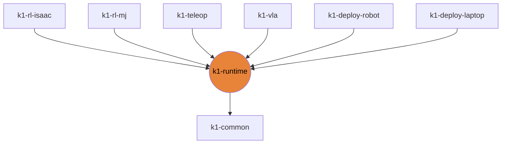

# k1-runtime

Torch/numpy-only policy runtime: WBC, push-IK core, arm IK, DS4 pad, gamepad core.

| | |
|---|---|
| Layer | **L1**: Core (torch / numpy only) |
| May import | [k1-common](https://github.com/thdhyan/k1-common) |
| Files / LOC | 7 files · 1,352 lines (py, sh, cpp) |
| Part of | [k1-workspace](https://github.com/thdhyan/k1-workspace) (architecture and layering rules live there) |

## Where it sits



Used by: k1-rl-isaac, k1-rl-mj, k1-teleop, k1-vla, k1-deploy-robot, k1-deploy-laptop.


## Install

```bash
uv add git+https://github.com/thdhyan/k1-runtime
# or, from a checkout
uv sync
```

## Layout

```
README.md
mjlab_k1/  (2 files)
  test/  (1 files)
  tests/  (1 files)
pyproject.toml
src/  (6 files)
  k1_runtime/  (6 files)
```

## Dependencies

- Declared sibling libraries: k1-common (see `pyproject.toml`, `[tool.uv.sources]`).
- PyPI: evdev, mujoco, numpy, torch.
- Provided by the environment (ROS 2, Isaac, mjlab, robot SDK) or unresolved: `booster_interface`, `rclpy`.

## `gamepad_core`

`k1_gamepad_deploy.py` was split in three: this repo keeps the shared half (gains, `Walker`, `Body`, `ArmJog`, `Gamepad`), [k1-deploy-robot](https://github.com/thdhyan/k1-deploy-robot) keeps `run_robot`, and [k1-deploy-laptop](https://github.com/thdhyan/k1-deploy-laptop) keeps the MuJoCo sim-to-sim (`gamepad_sim.py`). `CAP` (command limits) is a module global: set `gamepad_core.CAP` before building a `Gamepad`.

## Hard-coded paths into other repos

These files still name paths that now live in another repo (hard-coded path strings, not imports). Pass them as arguments / config when you touch the file:

| File | Refers to | Owner |
|---|---|---|
| `mjlab_k1/tests/test_wbc.py` | `mjlab_k1/` | k1-rl-mj |
| `src/k1_runtime/gamepad_core.py` | `mjlab_k1/` | k1-rl-mj |
| `src/k1_runtime/gamepad_core.py` | `mjlab_k1/deploy/` | k1-deploy-laptop |

## Origin

Extracted from `booster_ws` (branch `dev/push-training-wip`, working tree of 2026-11-03) by
`tools/build_workspace.py` in k1-workspace. Old path to new path for every file: [`docs/migration_map.tsv`](https://github.com/thdhyan/k1-workspace/blob/main/docs/migration_map.tsv) (filter on `k1-runtime`).
History was not carried over: the working tree was copied as is, including previously untracked files.
